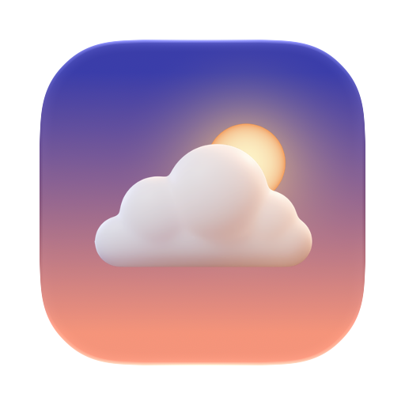

<p align="center"></p>

# Deepwork

A macOS menu bar app for focus time. Pick your hours, and only the apps and sites you allow get through.

**[Download](https://github.com/frinfo702/deepwork/releases/latest)** · [Website](https://frinfo702.github.io/deepwork/)

macOS 15+ · Apple Silicon & Intel

## Features

- **Weekly schedules**: as many focus blocks as you like, including ones that cross midnight
- **Quick focus**: start a 25, 50 or 90 minute session in one click, then pause, resume or reset it
- **Pomodoro**: focus rounds with short and long breaks. Lengths, the long-break interval, the number of rounds and auto-start are all yours to set
- **App and site lists**: allow only what you need, or block only what distracts you
- **No browser extension**: sites are filtered in Safari, Chrome, Arc, Dia, Edge, Brave, Vivaldi, Opera and Orion through AppleScript. Firefox can only be blocked as an app
- **Agent browsers stay free**: optionally leave browsers marked "controlled by automated test software" (Puppeteer, Playwright, chrome-devtools-mcp) unrestricted, so AI agents keep working
- **Strict mode**: settings, stopping and quitting stay locked until the session ends
- **Today at a glance**: focused time and blocked distractions, right in the menu bar

## Install

1. Unzip `Deepwork.zip` and move `Deepwork.app` to Applications.
2. The app isn't notarized yet. If macOS blocks it, click **Open Anyway** in System Settings › Privacy & Security, or run:
   ```sh
   xattr -dr com.apple.quarantine /Applications/Deepwork.app
   ```
3. Click the ☁️ in the menu bar and open **Settings…** to set your schedules and lists.

Deepwork updates itself from GitHub Releases. That check is its only network request, and you can turn it off in Settings.

## Build from source

Requires the Xcode Command Line Tools.

```sh
./build.sh   # outputs build/Deepwork.app
```

## Credits

Website background artwork: Dreamblur by [@uihssn](https://x.com/uihssn).
